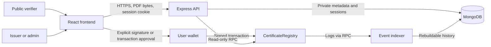

# Architecture

Phase 0 design, 10 October 2026, with the Phase 1 contract interface noted below. The smart-contract implementation and measured local cap are documented in [contracts/README.md](contracts/README.md); other components remain planned. Security details live in [SECURITY.md](SECURITY.md); the historical phase gates and operational configuration live in [IMPLEMENTATION_PLAN.md](IMPLEMENTATION_PLAN.md).

## 1. Repository structure

```text
/
├── README.md
├── ARCHITECTURE.md
├── SECURITY.md
├── IMPLEMENTATION_PLAN.md
├── package.json                 # private npm workspace + orchestration scripts
├── package-lock.json            # single committed JS dependency lock
├── .env.example                 # documented placeholders; real env files ignored
├── .gitignore
├── compose.yaml                 # local MongoDB, loopback binding, pinned image
├── contracts/
│   ├── foundry.toml             # exact compiler, optimizer and EVM target
│   ├── remappings.txt
│   ├── src/CertificateRegistry.sol
│   ├── test/                   # unit, fuzz and invariant tests
│   ├── script/                 # user-invoked deployment, no embedded keys
│   └── lib/                    # dependencies pinned to release/commit
├── backend/
│   ├── package.json
│   ├── src/
│   │   ├── app.ts              # app factory separate from listening process
│   │   ├── server.ts
│   │   ├── config/
│   │   ├── routes/
│   │   ├── middleware/         # auth, validation, limits, errors, CSRF
│   │   ├── services/           # hashing, verification, chain reads
│   │   ├── models/             # Mongoose schemas and indexes
│   │   └── indexer/            # replayable chain events and checkpoints
│   └── test/                   # Vitest/Supertest + real-service integration
├── frontend/
│   ├── package.json
│   ├── src/
│   │   ├── pages/              # public verify, issuer dashboard, admin
│   │   ├── components/
│   │   ├── hooks/
│   │   └── lib/                # wallet, API client, contract adapter
│   └── test/                   # React Testing Library
├── packages/shared/
│   ├── package.json
│   └── src/                    # public DTO schemas, generated ABI, chain types
├── deployments/                # public chain/address/block/code-hash manifests
├── scripts/                    # ABI export, test orchestration, local reset
├── tests/e2e/                  # Playwright and synthetic fixtures
└── .github/workflows/          # reproducible checks, added when approved
```

Only the four top-level Markdown files exist in Phase 0. npm manages the three TypeScript workspaces; Foundry manages Solidity separately. Shared exports must be browser-safe: no environment loader, database code, session internals or secrets. ABI generation is one-way from Forge output, with drift checked in CI. Deployment manifests are public; local ephemeral deployment output is ignored.

## 2. Components and trust boundaries



- **Contract:** authorization, immutable issuance commitment, revocation and events. No external calls, payment flow or file handling.
- **Frontend:** public verification, wallet authentication and transaction review, role-aware issuer/admin screens, batch previews and history. Hiding a button is not authorization.
- **Backend:** PDF validation/hash, SIWE/session management, metadata access, authoritative contract reads and history APIs. Its Ethers provider has no signer.
- **MongoDB:** supplementary metadata, drafts, sessions and event projections. Loss of metadata must not make a known chain record unknown or validly issued by itself.
- **Indexer:** an independently restartable process from the backend package; bounded polling and resumable event scans rather than infrastructure-heavy queues.

Use a Vite `/api` proxy locally and a single HTTPS origin with `/api` reverse proxy in deployment. The RPC and application server are trust dependencies for public users; expose chain ID, contract address and checked block so results can be independently inspected.

## 3. Identity and certificate models

### On-chain record

Registry mapping: `mapping(bytes32 certificateId => Certificate)`.

| Field | Solidity type | Rule |
| --- | --- | --- |
| `documentHash` | `bytes32` | Exact 32 raw bytes of the PDF's SHA-256 digest; reject all-zero value; not Keccak-256 or a text string |
| `issuer` | `address` | Nonzero `msg.sender` at issuance; also the existence sentinel |
| `issuedAt` | `uint64` | Block timestamp; not an independently authenticated graduation date |
| `issuedBlock` | `uint64` | Issuance block for confirmation policy without depending on the index |
| `revokedAt` | `uint64` | Zero initially; recorded on revocation |
| `revoked` | `bool` | Explicit flag; irreversible |

The mapping key is the certificate identifier; do not duplicate it inside the stored struct. No private student information or PDF contents appear in storage, calldata or events. This also excludes names, emails, roll numbers, course/grade information, PDF URLs, filenames, free-text revocation reasons and student wallets. The contract receives the digest only and cannot inspect or validate the original PDF.

Generate IDs with 32 cryptographically random bytes in the browser before finalizing a PDF that will contain its ID/QR. The draft endpoint accepts this proposed ID, or generates one with the backend CSPRNG if the PDF needs no embedded identifier. Display canonical `0x` plus 64 hex digits. Validate and normalize hex at boundaries, reject zero, and never derive IDs from student details. Uniqueness is enforced by the contract, including across revoked records. Draft reservations are not global chain reservations.

A record is scoped to `(chainId, contractAddress, certificateId)`. Operational storage additionally uses `deploymentId`, derived from the manifest's deployment transaction/block hash, to separate Anvil resets that can reuse addresses. A QR verification link contains the deployment reference and ID only. Generate any ID/QR in the final PDF **before** hashing; embedding the document's own hash afterward changes its bytes.

The same digest may appear under multiple IDs; content deduplication is not a security guarantee. PDF verification requires an ID, avoiding an authoritative reverse-hash index and ambiguous matches. Corrections require a new ID/PDF plus revocation of the old record; there is no overwrite or un-revoke operation. Expiry is outside the initial scope.

### MongoDB collections

| Collection | Main fields and constraints |
| --- | --- |
| `issuerProfiles` | Deployment, normalized wallet, institution display name, verification note, timestamps; unique `(deploymentId, wallet)`; admin-managed, not an on-chain role source |
| `certificateMetadata` | Deployment, certificate ID, issuer wallet, optional private student name/reference, course, award date, timestamps; unique `(deploymentId, certificateId)`; public DTO excludes private fields |
| `issuanceDrafts` | Random draft ID, deployment, owner wallet, proposed certificate ID/hash, upload byte count, optional metadata, expiration, proposed tx hash and lifecycle; bounded retention; no PDF bytes |
| `chainEvents` | Deployment, tx hash, block number/hash, log index, event type, ID, issuer/actor and decoded public data; unique `(deploymentId, txHash, logIndex)`; canonicality tracked |
| `indexerCheckpoints` | Deployment, scanned block/hash and confirmation checkpoint; unique deployment |
| `authChallenges` | Nonce hash, pre-auth session binding, exact message fields, issued/expiry/consumed times; unique nonce hash; atomic consume |
| `sessions` | Hash of opaque token, wallet, chain/deployment, CSRF binding, absolute expiry; no stored authorization entitlement |

MongoDB TTL cleanup is asynchronous: check expiration in application code on every use. Add indexes for issuer lists and event pagination; never accept raw client MongoDB query objects. Chain-derived fields are updated only by verified chain reads/indexing. Metadata attach/update requires an active issuing wallet that owns the matching on-chain record; drafts require the session owner. Platform admins manage issuer profiles and roles, but cannot revoke certificates and do not receive blanket access to student metadata. Default metadata retention is until issuer deletion; disclose it and support authenticated deletion. Demo data is synthetic.

## 4. Smart-contract interface and authorization

Use a non-upgradeable `CertificateRegistry` inheriting OpenZeppelin `AccessControlDefaultAdminRules`. Its single default admin and delayed two-step transfer reduce accidental admin transfer risk. The contract admin can grant and remove `ISSUER_ROLE`; these inherited mechanisms are documented by [OpenZeppelin](https://docs.openzeppelin.com/contracts/5.x/access-control).

Constructor proposal: `(address initialAdmin, uint48 adminTransferDelay)`. Require nonzero admin. Proposed delay: 60 seconds on local Anvil, 48 hours on Sepolia, with transfer behavior tested using Foundry time warps. Deployment does not automatically give the deployer/admin issuer privileges.

| Interface | Authorization and behavior |
| --- | --- |
| `ISSUER_ROLE()`; `MAX_BATCH_SIZE()` | Public role identifier and batch-cap getter; candidate cap 50, pending gas validation |
| `issueCertificate(bytes32 id, bytes32 documentHash)` | Active issuer only; reject zero values and any existing ID |
| `issueBatch(bytes32[] ids, bytes32[] documentHashes)` | Active issuer only; equal lengths, 1–`MAX_BATCH_SIZE()` records; same individual rules; one atomic transaction |
| `revokeCertificate(bytes32 id)` | Active original issuer only (default admin has no revocation power); reject unknown and already revoked; does not alter digest/issuer/issuance fields |
| `getCertificate(bytes32 id)` | Public view returning `(bool exists, Certificate record)`; absence is a normal result |
| `verifyCertificate(bytes32 id, bytes32 candidateDigest)` | Phase 1 public comparison view: `Unknown=0`, `Valid=1`, `Modified=2`, `Revoked=3`; unknown first, revoked before mismatch; a zero candidate is a mismatch for an existing active record; no confirmation/RPC-availability claim |
| `hasRole(bytes32 role, address account)` | Public role lookup, inherited |
| `grantRole(ISSUER_ROLE, wallet)` | Default admin, inherited authorization; reject zero issuer address via a narrow validated override |
| `revokeRole(ISSUER_ROLE, wallet)` | Default admin; disables future issuance and issuer revocation rights |
| `renounceRole(ISSUER_ROLE, callerConfirmation)` | Role holder, inherited confirmation rules |
| Default-admin transfer/delay functions | Inherited two-step workflow; do not bypass it through generic grant/revoke wrappers |

Admin renunciation is inherited and dangerous: it can permanently remove recovery/role administration; the UI must not offer it casually. Audit the full inherited ABI and zero-address override in Phase 2. Do not introduce a separate mutable database role system, pausing mechanism or custom role-admin hierarchy.

Events:

- `CertificateIssued(bytes32 indexed certificateId, address indexed issuer, bytes32 documentHash, uint64 issuedAt)` once per record, including batch entries. Block number comes from the log envelope.
- `CertificateRevoked(bytes32 indexed certificateId, address indexed issuer, address indexed revokedBy, uint64 revokedAt)`.
- Inherited `RoleGranted`, `RoleRevoked` and default-admin transfer/delay events; use these for issuer history rather than duplicate events.

Proposed custom errors: `ZeroCertificateId`, `ZeroDocumentHash`, `ZeroIssuerAddress`, `CertificateAlreadyExists`, `CertificateNotFound`, `CertificateAlreadyRevoked`, `NotCertificateAuthority`, `InvalidBatchLength`, `BatchTooLarge`, plus inherited OpenZeppelin access errors. Keep frontend decoding aligned with the generated ABI.

`MAX_BATCH_SIZE` remains a configurable design parameter with candidate value 50 until Phase 2 gas measurements validate it. Adjust the candidate during design/testing, then freeze the reviewed value as a contract constant before deployment; no runtime admin setter or environment-variable override of the on-chain bound is proposed. Frontend/backend batch validation and chunking use the deployed getter rather than a separately hard-coded 50. Measure worst-case fresh-record writes with the selected compiler/optimizer against the target block gas budget with headroom; a cap is not a guarantee that every transaction will fit current network conditions.

Sequential writes inside the batch loop naturally reject duplicate IDs in the same transaction; any failure reverts all records and logs. Estimate gas before each signing. The UI may split larger jobs into explicit chunks; each chunk is atomic, the whole job is not. Display each chunk's receipt and permit reconciliation before retries.

Ordinary revocation requires both `ISSUER_ROLE` at execution time and equality with the record's original issuer. `DEFAULT_ADMIN_ROLE` confers no revocation authority, including after an issuer is removed or loses its key; such certificates can then only be revoked if the same wallet is re-granted the role. Revocation irreversibly sets `revoked` and `revokedAt`, preserve the original record, emit the actor in `CertificateRevoked`, and reject unknown/already-revoked IDs. Admins need a separate issuer grant to issue certificates, and even then can revoke only their own; the admin role does not grant access to private student metadata.

Issuer removal does not erase the historical fact that the issuer was authorized at issuance. An existing certificate remains valid until individually revoked, even if its issuer loses its role. A removed issuer cannot revoke, and there is no admin recovery path; its certificates stay valid unless the same wallet is re-granted the role. Regranting the same wallet restores its original-owner revocation permission. Another wallet for the same institution does not inherit ownership automatically.

## 5. Wallet authentication and API authorization

Use [ERC-4361 SIWE](https://eips.ethereum.org/EIPS/eip-4361) with a maintained verifier. The server constructs a scoped message using a random single-use nonce, expected domain/URI, chain ID and short expiry. Verify the signature and every expected field, bind the challenge to the initiating browser, and atomically consume it to stop parallel replay.

Proposed policy: nonce lifetime 5 minutes, allowed clock skew 60 seconds, session absolute lifetime 8 hours. Successful login rotates the session identifier. Keep only its hash server-side; set an opaque `HttpOnly`, `SameSite=Lax`, host-only cookie, with `Secure` required outside local development. Use synchronizer CSRF tokens and exact Origin validation on state-changing cookie-authenticated requests, including login/logout. Never store bearer sessions in browser local storage.

Initial wallet support is EOA accounts. Smart-contract wallets/ERC-1271 authentication are a later extension; explicitly reject unsupported login rather than pretending support. Inherited contract roles can still be held by a contract wallet, but its dashboard authentication is outside initial scope.

Each protected action checks the authenticated wallet, expected chain/deployment, current contract role and record ownership as applicable. Roles in sessions or MongoDB are not authoritative. RPC failures deny the protected action with a dependency error; removing a role takes effect on the next server check and always at contract execution. On account/network changes, clear frontend authenticated state and require a new scoped login. Logout deletes the server session.

SIWE signs an authentication message, never a certificate transaction. Ethers separates provider reads from signer writes; browser writes use the connected wallet via `BrowserProvider` as described in [Ethers v6](https://docs.ethers.org/v6/getting-started/).

## 6. API boundaries and data flows

Proposed `/api/v1` surface:

| Route | Access and purpose |
| --- | --- |
| `POST /auth/challenge`, `POST /auth/verify` | Public, browser-bound and rate-limited SIWE exchange |
| `GET /auth/session`, `DELETE /auth/session` | Session status/logout; no secrets in response |
| `GET /certificates/:id/verification` | Public live chain verification; no student metadata |
| `POST /certificates/:id/verify-pdf` | Public single PDF upload + live digest comparison |
| `POST /issuance-drafts` | Active issuer; accept one PDF and bounded optional metadata; create ID/hash draft |
| `GET /issuance-drafts/:draftId` | Owner only; recover review state, never PDF content |
| `POST /issuance-drafts/:draftId/transaction` | Owner; submit a tx hash as a hint for reconciliation, not proof |
| `GET/PATCH/DELETE /certificates/:id/metadata` | Active original issuer; private metadata; chain ownership enforced |
| `GET /issuer/certificates`, `GET /issuer/drafts` | Current issuer's paginated records; index freshness shown |
| `GET/PUT /admin/issuers/:wallet/profile` | Current admin; supplementary institution profile only |
| `GET /admin/issuers` | Admin issuer list derived from role events and current role checks |
| `GET /certificates/:id/history` | Public canonical event history, no private metadata |
| `GET /health/live`, `GET /health/ready` | Liveness/dependency readiness; no credentials or stack traces |

There is no backend issue/revoke/grant transaction endpoint. Admin and issuer dashboards call the contract directly through the wallet. Shared runtime schemas validate IDs, hashes, addresses, dates, strings, pagination and request bodies; reject unexpected fields.

**Single issuance:** authenticate → check issuer role → upload finalized PDF → validate/hash transient bytes → save draft → display ID, SHA-256 digest, chain, contract and issuer → wallet estimates/simulates and signs issuance → track receipt → read contract to confirm exact ID/digest/issuer → attach metadata and mark draft reconciled. Submission alone never means issued. Drafts expire after 24 hours; an expired draft does not invalidate a mined certificate. If metadata saving fails after mining, report on-chain success and retry metadata separately.

**Batch issuance:** prepare up to the selected batch cap (candidate 50) individual drafts per transaction with bounded concurrency (initially 2 uploads at a time), review ordered ID/digest pairs, then send one batch call. Never accept an entire batch of full PDFs in a single unrestricted multipart request. Persist transaction-to-draft associations so refresh/restart can reconcile every member.

**Revocation and issuer management:** show the specific IDs/wallets and consequences → obtain the appropriate wallet approval → track transaction → refresh contract state → refresh index asynchronously. State changes may invalidate a previous simulation; handle revert, cancellation and transaction replacement without false success.

**Verification:** validate input/upload → read configured deployment and fresh block → read record at that block → apply the result table below → optionally attach safe metadata/history with explicit availability status. This path must still work when MongoDB is down; public verification uses an independent bounded in-process limiter if session storage is unavailable.

## 7. PDF hashing and verification semantics

Accept one file per upload, maximum `10 * 1024 * 1024` bytes (10 MiB), plus at most 64 KiB multipart overhead/fields. Enforce a 30-second request deadline, streaming byte limit even without Content-Length, concurrency limits, filename length and field count limits. Initial strict PDF admission requires a `.pdf` filename, declared `application/pdf`, `%PDF-` header at byte zero and a trailing `%%EOF` marker with only allowed trailing whitespace. Reject empty, truncated, oversized or unsupported uploads. These checks are a narrow admission policy, not a complete PDF parser or malware detector; some unusual valid PDFs may be rejected.

Hash the original file part with Node.js `createHash('sha256')`, consuming Buffer/chunks directly, and encode the 32-byte result as `0x` plus 64 lowercase hex digits. Do not hash multipart framing, filename, a UTF-8 decoding, base64 text, extracted text or a reserialized PDF. Node's [crypto hash API](https://nodejs.org/api/crypto.html#cryptocreatehashalgorithm-options) supports byte-oriented inputs. Do not normalize, optimize, annotate or sanitize the bytes before hashing. Release upload buffers on success, error and disconnect; never persist PDFs, extract embedded content or preview them in an active viewer.

The exact encoding contract is: Node `createHash('sha256').update(pdfBytes).digest()` produces a 32-byte Buffer; `'0x' + digest.toString('hex')` produces the canonical 66-character API/Ethers value. Ethers ABI-encodes that value directly as Solidity `bytes32`, preserving byte order and leading zero bytes. Solidity stores/emits those same 32 bytes without rehashing, string conversion, padding or truncation. API/MongoDB digest fields use the same canonical hex form; contract return values are normalized to it before equality comparison. Validate exactly 64 hex digits after `0x`; never use `encodeBytes32String`, `keccak256`, `Number` conversion or a second SHA-256 on the hex text. A future integration test must prove Node → Ethers ABI → Solidity storage/event → Node equality, including a digest with leading zero bytes; that test has not run in Phase 0.

`VerificationResult` includes `status`, `mode: id | pdf`, certificate ID, chain ID, contract address, checked block number/hash/time, issuer/digest/issuance fields when known, `documentMatch: true | false | null`, confirmation count, and a stable reason code. `documentMatch` is null for ID checks and unknown records. Results contain no student details.

Apply these rules in order after input validation:

| Condition | Result | UI meaning |
| --- | --- | --- |
| RPC timeout/failure, contract read revert/failure or invalid ABI return data, wrong chain, missing/mismatched contract code, stale head, inconsistent read/reorg | `unavailable` | Could not establish current authoritative state; retry |
| Successful read, `exists == false` | `unknown` | No record for this ID in this deployment at the checked block |
| Existing record, `revoked == true` | `revoked` | Revoked; include PDF match/mismatch separately if supplied |
| Existing unrevoked record below required issuance confirmations | `unavailable`, reason `CONFIRMATION_PENDING` | Observed issuance is awaiting confirmation |
| Confirmed existing unrevoked record, PDF digest differs | `modified` | Uploaded bytes do not match the registered document |
| Confirmed existing unrevoked record, PDF digest matches | `valid`, mode `pdf` | Exact uploaded bytes match; not revoked at this block |
| Confirmed existing unrevoked record, ID only | `valid`, mode `id` | Registered and not revoked; no document was checked |

Revocation takes precedence over a mismatched upload so both facts can be shown without hiding revocation. `modified` also covers uploading the wrong original PDF; it does not establish malicious intent. Resaving a visually identical PDF can change its digest. An unknown ID cannot establish document modification.

Use reason `RPC_UNAVAILABLE` for transport/provider failure and `CONTRACT_CALL_FAILED` for failed/reverted or undecodable certificate reads. A call error is never an absent record: only a successfully decoded `exists == false` result establishes `unknown`. Do not fall back to database/cache status or invent checked-block fields when the read did not complete; include only verified context and a safe error message.

Pending transaction status is separate from the verification verdict. An unmined issuance has not created a record: a successful public read returns `unknown` as of that block, while the submitting dashboard separately shows `submitted/pending`, never “issued.” Once mined but below the issuance threshold, return `unavailable / CONFIRMATION_PENDING`. A pending revocation does not yet change the record; verification reports current mined state (which can still be `valid`) and a dashboard that knows the transaction shows “revocation pending.” Never infer permanent absence or future validity from these results, and never query the RPC `pending` state as authoritative verification. An arbitrary client tx hash cannot override the verdict. Receipt lookup failures leave transaction progress unresolved; independently successful certificate reads remain usable.

Use HTTP 200 for completed `valid/unknown/modified/revoked` checks, 503 for `unavailable` (including mined issuance awaiting required confirmations), 400 for malformed IDs/schema, 413 for too-large uploads, 415 for unsupported type and 422 for rejected PDF structure. Auth failures use 401/403, rate limits 429 and unexpected application failures 500 with a safe error envelope. The UI maps network/500 errors to an unavailable display, never to a certificate verdict.

Read the latest observed head, pin all record reads to its number, and recheck its hash before returning. A detected change causes a bounded retry, then `unavailable`. Responses use `Cache-Control: no-store` and explicitly mean “as of block X”, not permanent validity. Proposed issuance threshold: 1 confirmation locally and 2 on Sepolia, measured as `head - issuedBlock + 1`; two blocks are not economic finality. Always report revocation observed at the latest head immediately rather than waiting for the history index. Reject stale public-network heads (initial threshold 120 seconds); disable wall-clock age gating on idle instant-mining Anvil while keeping connection and code checks.

## 8. History, confirmations and recovery

Indexer scans start at the deployment block, filter the exact contract address/topics and persist block hashes, with bounded ranges and retries. It checks checkpoint ancestry on restart, rescans an overlap of 12 blocks, and rolls back/replays from a known common ancestor on mismatch; deeper reorgs require walking back further or rebuilding from deployment. Do not assume the overlap bounds every reorg. Local chain reset creates a new deployment namespace and invalidates prior sessions/drafts/configuration; never silently merge it with old data.

Transaction lifecycle: `awaiting_signature → submitted → mined_unconfirmed → confirmed`, with `rejected`, `reverted`, `replaced`, `dropped` and `orphaned` branches. A timeout leaves status unresolved until reconciled. Receipt status, chain, destination, canonical block hash, decoded registry events and stored record values must all agree before attaching issuance metadata. A client-supplied successful transaction elsewhere is not evidence. Replacement hashes must be reconciled, not blindly retried under a new ID.

History is indexed evidence, not the current revocation authority. Return `indexedThroughBlock`, lag/canonicality and unavailable indicators; an incomplete or offline index must not appear as an authoritative empty history. Public history and issuer lists use bounded cursor pagination. Certificate state remains independently verifiable through the contract.
